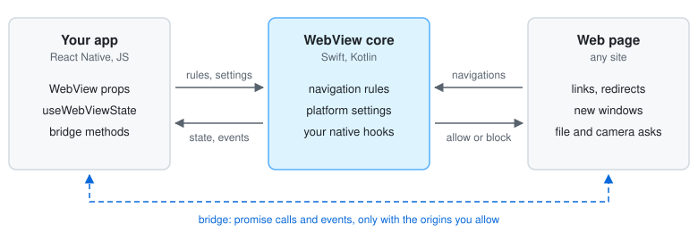

# react-native-minimal-webview

A React Native WebView that hands you the iOS and Android WebView APIs, instead of wrapping each one in a prop.

It runs on iOS and Android as an Expo module.

[Install](#install) ·
[API reference](https://rasmuskard.github.io/react-native-minimal-webview/typescript/react-native-minimal-webview/) ·
[Examples](guides/examples.md) ·
[Native hooks](guides/native-hooks.md) ·
[Migrating from react-native-webview](guides/migrating-from-react-native-webview.md) ·
[Extensions](https://rasmuskard.github.io/react-native-minimal-webview/typescript/extensions/) ·
[MIT license](https://github.com/RasmusKard/react-native-minimal-webview/blob/main/LICENSE)

## Why it exists

react-native-webview wraps each platform API in a prop of its own. When one isn't wrapped, you wait for an upstream
PR, or patch or fork the package, even if the change is one platform call.

This package passes the platform APIs through instead:

- `ios` and `android` props: any setting, by its platform name.
- The ref's `get` and `call`: properties and methods, by name.
- [Native hooks](guides/native-hooks.md): the `WKWebView` or `WebView` itself, in your own Swift or Kotlin
  module.

```tsx
import { useRef } from 'react';
import { Button, Platform } from 'react-native';
import { WebView, type WebViewRef } from 'react-native-minimal-webview';

export function Browser() {
  const ref = useRef<WebViewRef>(null);
  const pageDown = () => {
    if (Platform.OS === 'android') ref.current?.call('webView.pageDown', [true]);
  };
  return (
    <>
      <Button title="Page down" onPress={pageDown} />
      <WebView
        ref={ref}
        source={{ uri: 'https://example.com' }}
        style={{ flex: 1 }}
        ios={{ scrollView: { bounces: false } }}
        android={{ settings: { textZoom: 120 } }}
      />
    </>
  );
}
```

A setting or method a newer SDK adds works without a release of this package: see
[`ios`](https://rasmuskard.github.io/react-native-minimal-webview/typescript/react-native-minimal-webview/interfaces/WebViewProps/#ios),
[`android`](https://rasmuskard.github.io/react-native-minimal-webview/typescript/react-native-minimal-webview/interfaces/WebViewProps/#android) and
[`call`](https://rasmuskard.github.io/react-native-minimal-webview/typescript/react-native-minimal-webview/type-aliases/WebViewRef/#call).

## What it changes from react-native-webview



The core adds only what the platform APIs lack:

|                            | react-native-webview                                 | react-native-minimal-webview                |
| -------------------------- | ---------------------------------------------------- | ------------------------------------------- |
| Navigation decisions       | `onShouldStartLoadWithRequest`, a JS round trip each | `navigationRules`, matched natively         |
| Page messaging             | `postMessage` strings, any page                      | Typed promise bridge, `allowedOrigins` only |
| Navigation state           | `onNavigationStateChange` events you keep in state   | `useWebViewState(ref)`                      |
| Page camera and microphone | Granted to any page on Android, after asking the OS  | Your app answers `onPermissionRequest`      |

The [migration guide](guides/migrating-from-react-native-webview.md) covers each react-native-webview prop that works differently here.

## When to use something else

- Old architecture, Windows or macOS: react-native-webview supports them, this package doesn't. Neither runs on web.
- Expo Go: the package has native code, so it needs a development build.

## Install

```sh
npx expo install react-native-minimal-webview
```

Then rebuild the app (`npx expo run:ios`, `npx expo run:android`).

A bare React Native app adds Expo modules first, then installs with its package manager:

```sh
npx install-expo-modules@latest
npm install react-native-minimal-webview   # or: yarn add, pnpm add
npx pod-install
```

### Requirements

| Platform     | Minimum                                                                        |
| ------------ | ------------------------------------------------------------------------------ |
| iOS          | 17.0: `ios.deploymentTarget: '17.0'`, for example with `expo-build-properties` |
| Android      | API 29: `android.minSdkVersion: 29`, for example with `expo-build-properties`  |
| Expo SDK     | 53 (React Native 0.79, React 19)                                               |
| Architecture | New architecture only                                                          |

Some features need a newer Android System WebView: [which ones](guides/android-system-webview.md).

## Usage

```tsx
import { WebView } from 'react-native-minimal-webview';

export function Browser() {
  return <WebView source={{ uri: 'https://example.com' }} style={{ flex: 1 }} />;
}
```

Then pick what you need:

| To                                                                                | See                                                                                                                          |
| --------------------------------------------------------------------------------- | ---------------------------------------------------------------------------------------------------------------------------- |
| Show the URL, progress or a back button                                           | [Navigation state](guides/examples.md#navigation-state)                                                                      |
| Keep the WebView on your sites, open the rest externally                          | [Navigation rules](guides/examples.md#navigation-rules)                                                                      |
| Call the page from the app, and the app from the page                             | [The bridge](guides/examples.md#the-bridge)                                                                                  |
| Change a WebView setting                                                          | [Platform settings](guides/examples.md#platform-settings)                                                                    |
| Share cookies with native requests                                                | [Cookies](guides/examples.md#cookies)                                                                                        |
| Run a script on every page                                                        | [Scripts](guides/examples.md#scripts)                                                                                        |
| Load bundled HTML                                                                 | [Local files](guides/examples.md#local-files)                                                                                |
| Answer file pickers, permissions and downloads                                    | [Page requests](guides/examples.md#page-requests)                                                                            |
| Use the native `WKWebView` or `WebView`                                           | [Native hooks](guides/native-hooks.md)                                                                                       |
| Bring back `basicAuthCredential`, `onScroll` and other react-native-webview props | [@react-native-minimal-webview/extensions](https://rasmuskard.github.io/react-native-minimal-webview/typescript/extensions/) |

## Contributing

[CONTRIBUTING.md](https://github.com/RasmusKard/react-native-minimal-webview/blob/main/.github/CONTRIBUTING.md) has the setup, the checks and the on-device suites.
