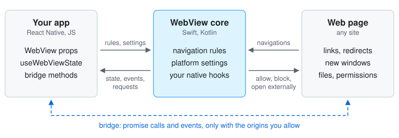

# How it works

What runs where, and the terms the rest of the docs use: the core, frames, origins, rules and the bridge.

## The parts

| Part          | What it is                                                                                  | What it does                                                                                     |
| ------------- | ------------------------------------------------------------------------------------------- | ------------------------------------------------------------------------------------------------ |
| The page      | Your site, in the platform's WebView: `WKWebView` on iOS, Android System WebView on Android | Runs in the WebView's own process, the renderer, apart from the app                              |
| The core      | This package's Swift and Kotlin around that WebView                                         | Decides navigations, keeps the navigation state, answers the page's requests, carries the bridge |
| Your app's JS | The `<WebView>` props, its ref and your callbacks                                           | Hands the core its rules and settings, and hears what happened                                   |
| A native hook | Your own Swift or Kotlin, optional                                                          | Gets the native WebView itself ([native hooks](native-hooks.md))                                 |

The core decides natively, from what the props gave it, so a busy JS thread doesn't hold the page up. JS is asked only
where a prop says so: an `ask` rule ([`onNavigationRequest`][onnavigationrequest]) an `external` navigation when you pass
[`onOpenExternal`][onopenexternal], and the page's requests for files and permissions ([page requests](examples.md#page-requests)).

## Frames and origins

The **main frame** is the page's top-level document, the one whose URL the navigation state shows. Every `<iframe>` in
it is a frame of its own, a subframe.

An **origin** is a scheme, host and port, as the page's `location.origin` writes it: `https://example.com`. A page from
a `data:` URL or in a sandboxed iframe has an opaque origin, which only `'*'` matches.

The core gives the main frame more than it gives iframes, and trusts only the origins you name:

| Feature                             | Main frame                       | Iframes                                                                 |
| ----------------------------------- | -------------------------------- | ----------------------------------------------------------------------- |
| [Navigation state][navigationstate] | Its `url` is this frame's        | Never change its `url`                                                  |
| [Navigation rules][navigationrule]  | Decided                          | Decided on iOS; on Android only for non-http(s) URLs                    |
| [The bridge][allowedorigins]        | On the bridge's `allowedOrigins` | Never                                                                   |
| [Injected scripts][injectedscript]  | On the script's `origins`        | Only with `allFrames`, each frame matched by its own origin             |
| [`evaluate`][evaluate]              | Runs here                        | Never                                                                   |
| [Camera and microphone][permission] | Asks your `onPermissionRequest`  | Denied without asking, except on Android one on the main frame's origin |

So a third-party iframe in your page can't reach the bridge, doesn't run your scripts unless you opt in for its own
origin, and gets neither the camera nor the microphone. Each row's link has the exact rule and its platform differences.

Every origin a bridge allows gets the same trust. A handler that should answer one of them only checks the
[`sender`][bridgesender] it gets.

## How a navigation is decided

1. The `source` load, a reload and back or forward load without asking the rules. So do a form POST and an `about:`,
   `data:` or `javascript:` URL.
2. Any other navigation goes down [`navigationRules`][navigationrules], and the first rule that matches decides:
   `allow`, `block`, `external` or `ask`.
3. A navigation no rule matches is blocked.

Without the prop, the rules are [`defaultNavigationRules`][defaultnavigationrules]. [`onNavigation`][onnavigation]
reports every decision with the index of the rule that made it, which is the quickest way to see why a link did what it
did.

## When a prop takes effect

Two props are read when the native WebView is created, so changing them recreates it: the page reloads and the
navigation state starts over.

- [`bridge`][bridge], which is compared by identity: make it once, with `useMemo` or at module scope.
- [`ios.configuration`][configuration], which is compared by value: an inline object with the same values is no change.

Every other prop applies at once or from the next navigation, as its reference entry says. One exception: a native
hook that takes part in creating the WebView attaches only then ([`extensions`][extensions]). A callback is read when its
event comes, so an inline function costs nothing.

## Which interface to use

Start with a prop. For a platform setting or method the package has no prop for, [use a platform API](platform-apis.md)
through the `ios` and `android` props or the ref's `get` and `call`. For a delegate or client callback, native state or
a WebView subclass, write a [native hook](native-hooks.md#when-to-write-one).

[onopenexternal]: https://rasmuskard.github.io/react-native-minimal-webview/typescript/react-native-minimal-webview/interfaces/WebViewProps/#onopenexternal
[extensions]: https://rasmuskard.github.io/react-native-minimal-webview/typescript/react-native-minimal-webview/interfaces/WebViewProps/#extensions
[onnavigationrequest]: https://rasmuskard.github.io/react-native-minimal-webview/typescript/react-native-minimal-webview/interfaces/WebViewProps/#onnavigationrequest
[navigationstate]: https://rasmuskard.github.io/react-native-minimal-webview/typescript/react-native-minimal-webview/type-aliases/NavigationState/
[navigationrule]: https://rasmuskard.github.io/react-native-minimal-webview/typescript/react-native-minimal-webview/type-aliases/NavigationRule/#mainframe
[allowedorigins]: https://rasmuskard.github.io/react-native-minimal-webview/typescript/react-native-minimal-webview/type-aliases/BridgeOptions/#allowedorigins
[injectedscript]: https://rasmuskard.github.io/react-native-minimal-webview/typescript/react-native-minimal-webview/type-aliases/InjectedScript/
[evaluate]: https://rasmuskard.github.io/react-native-minimal-webview/typescript/react-native-minimal-webview/type-aliases/WebViewRef/#evaluate
[permission]: https://rasmuskard.github.io/react-native-minimal-webview/typescript/react-native-minimal-webview/type-aliases/PermissionRequest/
[bridgesender]: https://rasmuskard.github.io/react-native-minimal-webview/typescript/react-native-minimal-webview/type-aliases/BridgeSender/
[navigationrules]: https://rasmuskard.github.io/react-native-minimal-webview/typescript/react-native-minimal-webview/interfaces/WebViewProps/#navigationrules
[defaultnavigationrules]: https://rasmuskard.github.io/react-native-minimal-webview/typescript/react-native-minimal-webview/variables/defaultNavigationRules/
[onnavigation]: https://rasmuskard.github.io/react-native-minimal-webview/typescript/react-native-minimal-webview/interfaces/WebViewProps/#onnavigation
[bridge]: https://rasmuskard.github.io/react-native-minimal-webview/typescript/react-native-minimal-webview/interfaces/WebViewProps/#bridge
[configuration]: https://rasmuskard.github.io/react-native-minimal-webview/typescript/react-native-minimal-webview/type-aliases/IOSSettings/#configuration
